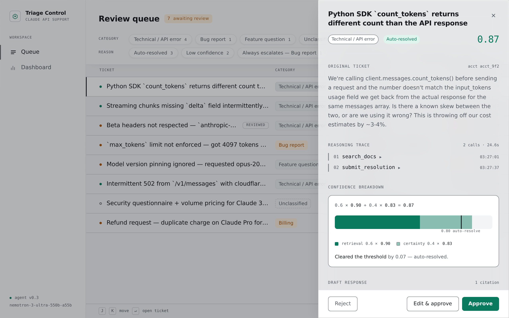

# Claude Support Triage Agent

An AI agent that triages Claude API developer support tickets end-to-end: it
classifies the ticket, grounds itself in Anthropic's real public
documentation, calls live and mocked tools, drafts a citable response with
two independent confidence signals, and hands off to a human whenever the
category or the confidence says it should. A rules-based routing engine —
not the model — makes that final call, and every tool call is logged so any
decision is fully explainable after the fact.

*Independent portfolio project. Not affiliated with or endorsed by
Anthropic. Grounding corpus is Anthropic's public documentation only — no
private or scraped data anywhere in this repo (see [Data policy](#data-policy)).*

## Why this exists

Every API company's support queue splits into two very different tiers: a
large volume of repetitive, doc-answerable questions (rate limits, pricing,
migration steps) and a smaller tier of genuinely sensitive tickets — billing
disputes, security reports, enterprise sales, bug reports — where a wrong
autonomous answer is expensive. Most triage tooling treats every ticket the
same. This project asks a narrower question: can an agent tell the
difference, answer the first tier on its own with citations, and route the
second tier to a human with enough context that the human doesn't have to
start from zero?

## Screenshots


| Review queue | Ticket detail |
|---|---|
|  |  |


*(Screenshots and GIFs use synthetic fixture data for illustration — see
[Data policy](#data-policy).) The deployed app opens on an intro page at `/`
(features, a walkthrough, an interactive routing calculator that runs the real
`route()`, results and architecture); **Try now** opens the queue.*

## Results

Two full runs of the same 40-ticket synthetic dataset through the identical
routing formula — only the orchestration model changed. This was a
deliberate experiment, not an accident: `OPENROUTER_MODEL` is an environment
variable specifically so the free-vs-paid comparison could be measured
rather than guessed at.

| | Free (`nemotron-3-ultra:free`) | Paid, Exacto-routed (`deepseek-v3.2:exacto`) |
|---|---|---|
| Auto-resolved | 8 (20%) | 15 (37.5%) |
| Escalated | 12 (30%) | 22 (55%) |
| Incomplete — no `submit_resolution` call | 20 (50%) | 3 (7.5%) |
| Cost | $0 | $0.25 |

**The finding, not just the number:** the free model misses the forced
`submit_resolution` tool call on roughly 40–50% of tickets. OpenRouter's
Exacto tool-calling-accuracy routing isn't offered on `:free` model slugs,
so there's no configuration fix while staying at $0 — this is a disclosed
reliability/cost tradeoff, stated plainly rather than hidden. The paid run
is what the live queue and dashboard demonstrate against; `orchestrator.ts`
still defaults to the free model and only switches on an explicit env
override, so the comparison stays reproducible.

## Evaluation

The free-vs-paid run above counts outcomes; it can't say whether a routing
decision was *right*. So all 40 tickets were hand-labeled with a gold category
and a gold route (needs a human / docs-answerable) under a written policy
([`evals/labels.json`](evals/labels.json)), plus 12 hard cases
([`evals/hard-cases.json`](evals/hard-cases.json)). The agent was then rerun
3 times per ticket and scored against the labels.

**Headline metric: must-escalate recall.** Of the tickets that need a human,
the share that reached one. A bot confidently answering a billing dispute or
a security report is the expensive failure. Four routing variants were scored
on the same agent runs; the one marked *shipped* is what production runs.

<!-- eval:start -->
| `qwen/qwen3.7-flash`, 40 labeled tickets × 3 seeds | Must-escalate recall | Unsafe auto-resolves / run | Auto-resolve precision | Coverage |
|---|---:|---:|---:|---:|
| Original routing (model-reported retrieval) | 93.1% (87.5%–95.8%) | 1.7 (1–3) | 84.7% (75.0%–91.7%) | 26.7% (20.0%–30.0%) |
| **Original + safety net — shipped** | 93.1% (87.5%–95.8%) | 1.7 (1–3) | 84.7% (75.0%–91.7%) | 26.7% (20.0%–30.0%) |
| Cosine retrieval instead — rejected | 86.1% (75.0%–95.8%) | 3.3 (1–6) | 71.7% (50.0%–90.0%) | 28.3% (25.0%–30.0%) |
| Cosine retrieval + safety net — rejected | 86.1% (75.0%–95.8%) | 3.3 (1–6) | 71.7% (50.0%–90.0%) | 28.3% (25.0%–30.0%) |

*Mean over seeds, min–max in parentheses. Safety net on the ticket text alone: fires on 15/52 tickets, catches 15/19 billing/security/sales tickets, 0 false hits. Full report: [EVALUATION.md](docs/EVALUATION.md).*
<!-- eval:end -->

<!-- eval-notes:start -->
- **Cosine similarity did not earn its place; rejected.** Swapping the model's self-reported retrieval score for the search's own cosine similarity lowered must-escalate recall from 93.1% to 86.1% and raised unsafe auto-resolves from 1.7 to 3.3 per run. As a ranking signal, cosine alone (AURC 0.393) does worse than no ranking at all (0.354). Similarity measures whether a ticket is on-topic for the docs, not whether the docs can resolve it. Paired over the same runs with a ticket-level bootstrap, the recall gap is 6.9 pts (95% CI 0.0 to 15.2) and the AURC gap 0.090 (-0.044 to 0.242): every gap points the same way, but none is significant on 40 tickets. The decision rests on that: no evidence the change helps and every point estimate says it hurts, so production keeps the model's score.
- **The 0.6/0.4 weights are a prior, not a fit.** The blend ranks only slightly better than self-certainty alone (AURC gap 0.006, 95% CI -0.038 to 0.061), so the data neither supports nor rules out re-weighting; with 40 tickets, fitting weights would overfit the labels.
- **The safety net works, but this model didn't need it.** On the ticket text alone it fires on 15/52 tickets, catches 15/19 gold billing/security/sales tickets and makes 0 false hits. It changed 0 routing decisions, because the model had already labeled every one of those tickets correctly. Shipped as a free backstop for a model that mislabels; its misses are the deliberately disguised hard cases.
- **The "bug reports always escalate" rule barely fires.** Only 5 of 21 bug-report runs were labeled `bug_report`; most were filed as `technical_api_error` and reached a human only through low confidence. Category rules are only as good as the classifier.
- **Exacto routing helps the same model finish.** On `openai/gpt-oss-120b`, completion went from 77.5% to 95.0% (Fisher p = 0.048) at 7.2× lower cost per ticket; the must-escalate recall difference is not significant (p = 0.67).
<!-- eval-notes:end -->

## Multi-agent: an independent checker and a researcher/writer split

Two additions, each measured on the same labeled tickets
([docs/MULTI_AGENT.md](docs/MULTI_AGENT.md)):

- **Router + independent checker.** Before an auto-resolve ships, a second
  agent on a different model family sees *only* the ticket and the proposed
  route. It has no tools and can only answer `agree` or `escalate`; code
  applies the verdict and fails closed. A second model can only make things
  safer — the eval measures what that costs.
- **Researcher → writer.** One agent only searches and hands over passages;
  a second writes the reply from those passages alone and cites one for every
  claim. Code checks each citation against what was actually handed over, and
  an uncited claim or a "the docs don't cover this" sends the ticket to a
  human. Measured with an LLM judge from a third model family, validated on
  planted fabrications first.

In `npm run run-triage`, the checker is **on by default** (`CHECKER=off` is the
kill switch; `CHECKER_MODEL=qwen/qwen3.7-flash` is the gentler same-model
option, see the coverage numbers below), and the split is opt-in with
`-- --pipeline split`. Every checker, researcher and writer call is logged to
`tool_calls`. The live demo queue still shows the earlier single-agent run.

<!-- multi:start -->
| qwen/qwen3.7-flash, 40 labeled tickets | Must-escalate recall | Unsafe auto-resolves / run | Coverage | Extra $ / ticket |
|---|---:|---:|---:|---:|
| Router alone (shipped) | 93.1% | 1.7 | 26.7% | — |
| + independent checker (deepseek-v4-flash) | 100.0% | 0.0 | 7.5% | +$0.00005 |
| + same-model checker | 97.2% | 0.7 | 18.3% | +$0.00003 |

| Grounding (all completed replies, core + hard) | Unsupported claims / reply | Replies with any unsupported claim |
|---|---:|---:|
| Single agent | 11.67 | 97.8% |
| Researcher → writer | 2.15 | 75.7% |

- **The independent checker trades coverage for safety.** On the 40 core tickets × 3 seeds, a deepseek-v4-flash checker took must-escalate recall from 93.1% to 100.0% (no unsafe auto-resolve got through in any of the 120 runs; conservative ticket-level 95% lower bound 86.2%) (paired change 6.9 pts, 95% CI 1.3 to 14.3 pts) and unsafe auto-resolves from 1.7 to 0.0 per run, but coverage fell from 26.7% to 7.5% (CI -28.4 to -10.8 pts). It caught 5/5 unsafe auto-resolve proposals and blocked 18/27 safe ones. Extra cost: $0.00005 per ticket.
- **A different model family caught more, and blocked more.** The same-model checker (same prompt, qwen3.7-flash) caught 3/5 unsafe proposals and blocked 7/27 safe ones: recall 97.2% (paired change 4.2 pts, CI 0.0 to 11.1 pts), coverage 18.3%. With only 5 unsafe proposals to catch, the catch-rate gap is suggestive, not established; the false-alarm gap is the larger effect.
- **The researcher → writer split cuts unsupported claims.** Graded by openai/gpt-6-luna against the evidence each writer actually had, unsupported claims per reply went from 11.67 (single agent) to 2.15 (paired change -9.58, 95% CI -10.90 to -8.27). Split replies are also shorter (9.0 vs 20.3 claims), so the length-fair number is the share of claims unsupported: 57.5% → 24.0%. On replies that would actually auto-send: 50.6% → 13.2%. It is not zero: 75.7% of split replies still hold at least one unsupported claim, because a citation proves the writer pointed at a passage, not that the passage says what the sentence says.
- **Citations to pages never retrieved.** 9 of the single agent's 264 citations point to a URL none of its searches returned; the split's are 0 of 334, by construction (code builds them from passages actually handed over).
- **The split's routing.** Must-escalate recall 89.6% → 97.9% (paired 8.3 pts, CI 0.0 to 19.0 pts), coverage 31.3% → 10.0% (CI -33.7 to -8.8 pts), cost $0.0017 → $0.0022 per ticket. The writer called only 33.0% of tickets fully answerable from the passages it was given, and its certainty dropped with it, so most unsupported drafts fell below the confidence threshold before the grounding gate was reached; the gate itself changed 3 decisions. The citation check passed on 58.3% of completed split replies.
- **The judge was checked before it was trusted.** It flagged 12/12 planted fabrications and accepted 10/10 sentences copied verbatim from the evidence.
- **Prompt-injection probes (6).** Escalated with no canary leak: single agent 5/6, with checker 6/6; split 6/6, with checker 6/6. The checker alone, shown each probe as a proposed auto-resolve, escalated 6/6. Canary leaks in any draft: 0.
<!-- multi:end -->

## Architecture

```
docs.claude.com   ─┐
support.claude.com ─┼─▶ ingestion (chunk + embed) ─▶ Supabase / pgvector
status.claude.com  ─┘

ticket ─▶ agent orchestrator (tool-calling loop) ─▶ routing engine ─┬─▶ auto-resolve
              │                                                      └─▶ human review queue
              ▼                                                            │
        tool_calls (audit trail) ◀───────────────────────────────────────┘
                                                                             │
                                                                             ▼
                                                                   reporting dashboard
```

**Agent loop** (`src/lib/agent/orchestrator.ts`) — an OpenAI-compatible
tool-use loop (via OpenRouter) that runs one ticket at a time: the model
calls `search_docs` (pgvector similarity search over the ingested corpus),
`check_status` (a live call to Anthropic's real status page),
`check_pricing`, and `lookup_account` (mocked) as needed, then is forced to
call `submit_resolution` exactly once with a structured category, draft
response, citations, and two confidence numbers. Every call — including the
final one — is written to `tool_calls`, so the reasoning trace in the UI is
reconstructed from the actual audit log, not a summary.

**Routing engine** (`src/lib/agent/routing.ts`) — a small, pure,
independently-tested function, deliberately *not* the model, that makes the
auto-resolve/escalate decision:

```
confidence = 0.6 × retrieval_score + 0.4 × self_certainty

route(ticket):
  if category in [billing, security_abuse, sales_enterprise, bug_report]:
    → escalate, reason = "category:" + category
  elif confidence ≥ 0.8:
    → auto_resolve
  else:
    → escalate, reason = "low_confidence"
```

The four sensitive categories always escalate regardless of how confident
the model claims to be — confidence is treated as a signal that's allowed to
influence routing only where being wrong is cheap. Retrieval quality and
self-reported certainty are also kept as two separate, visible numbers
rather than one opaque score, specifically so a reviewer can tell "the docs
didn't have this" apart from "the docs had it but the model wasn't sure" at
a glance — that distinction drives the dashboard's doc-gap view.

**Data layer** (`src/lib/data/{types,classify,queries}.ts`) — the single
place a raw Postgres row becomes a *meaning* (`resolved | escalated |
incomplete | rate_limited`), so the review queue and the reporting dashboard
can never disagree about what a ticket's outcome was. This module exists
because getting it wrong silently corrupted dashboard metrics twice during
development — see [Engineering notes](#engineering-notes).

## Project structure

```
scripts/
  ingest-docs.ts        Crawl + chunk + embed docs.claude.com / support.claude.com → Supabase
  generate-tickets.ts    Generate ~40 synthetic support tickets via OpenRouter (never scraped)
  run-triage.ts          Run every ticket through the agent loop, write results, print a summary

src/lib/
  agent/
    tools.ts             Tool schemas + implementations (search_docs, check_status, check_pricing, lookup_account)
    orchestrator.ts       The tool-calling loop for one ticket; logs every call to tool_calls
    routing.ts             Pure confidence + routing logic (independently self-tested)
  data/
    types.ts               Shared shapes for the UI layer
    classify.ts             classifyOutcome / parseCitations — pure, side-effect-free, self-tested
    queries.ts               Server-only Supabase reads that assemble the above into UI-ready shapes
  model.ts                  Single source for "which model is running" (env var + display name)
  supabase.ts, embeddings.ts  Supabase admin client, OpenRouter embeddings client

src/app/
  page.tsx                   Intro / marketing page (/)
  (app)/layout.tsx             Sidebar shell shared by the working screens
  (app)/queue/page.tsx         Review queue (/queue)
  (app)/dashboard/page.tsx     Reporting dashboard (/dashboard)
  actions.ts                    Server action for the approve/edit/reject review write-path

src/components/
  landing/                      Intro page: animated hero, walkthrough, routing calculator, results, diagrams
  queue/                        Filterable, keyboard-navigable (j/k/Enter) ticket list
  drawer/                        Ticket detail: reasoning trace, confidence breakdown, cited draft, review actions
  dashboard/                     KPI cards, escalation breakdown charts, doc-gap list

supabase/migrations/            Schema, pgvector setup, RLS + search_path hardening (0001–0005)
```

## Data policy

Grounding corpus is `docs.claude.com` and `support.claude.com` public pages
only. Account data (`accounts` table) is entirely mocked. Test tickets are
LLM-generated synthetic data — never scraped from a real user, forum post,
or support thread. No real Anthropic customer or account data exists
anywhere in this repository.

## Security

Before making this repository public, a Supabase advisor pass plus a manual
review caught Row-Level Security disabled on all six tables, and a prior
unrelated fix that had additionally granted the `anon`/`authenticated` roles
full read/write privilege — meaning the first client-side call made with the
publishable key would have gotten unauthenticated access to every table.
Nothing had broken in practice only because the app is entirely
server-side; that was luck, not design, until `0005_rls_and_search_path.sql`
closed it with two independent layers: revoked grants and RLS enabled with
default-deny. Model-generated citation links and inline markdown links are
also allowlisted to `http(s):` before ever becoming a real `href`, so a
`javascript:`/`data:` URI in a draft response can't render as a clickable
link.

## Engineering notes

A few bugs surfaced during development were worth keeping notes on because
they were the dangerous kind — silent, not crashing:

- **Outcome reclassification bug.** `classifyOutcome` originally read
  `tickets.status` to distinguish resolved from escalated — but the review
  write-path overwrites that same column to `reviewed` on approve/reject,
  silently reclassifying a ticket's outcome the moment anyone reviewed it
  and corrupting every dashboard stat retroactively. Fixed by deriving the
  outcome purely from the immutable `escalation_reason` field instead.
- **A CSS minifier silently dropped a rendering effect.** Next's Turbopack
  CSS minifier saw `backdrop-filter` and `-webkit-backdrop-filter` declared
  adjacently with identical values and treated them as redundant, shipping
  only the vendor-prefixed one — which current Chromium no longer renders on
  its own. The glass panels looked like flat, unblurred boxes with no error
  anywhere. Caught via `getComputedStyle` on the built output, not by eye;
  fixed by splitting the declarations into separate `@supports` blocks.
- **Untrusted model output cast without validation.** A non-numeric
  `self_certainty`/`retrieval_score` from the model would silently become
  `NaN` once cast to `Resolution`. Now coerced and validated before use.

## Tech stack

- **Next.js (App Router) + TypeScript**, strict mode, no client-side data
  fetching for the review UI — server components read Supabase directly
- **Supabase** — Postgres, `pgvector` for the doc-chunk embedding store, RLS
  enabled with a default-deny policy (server-side admin client bypasses it
  intentionally; there is no client-side write path in v1)
- **OpenRouter** — the only model provider in this repo, used via the
  OpenAI-compatible `/chat/completions` and `/embeddings` endpoints; the
  orchestration model is swappable via `OPENROUTER_MODEL` (see
  [Results](#results))
- **Vercel** — deploy target

## Setup

```bash
npm install
cp .env.local.example .env.local   # fill in Supabase + OpenRouter credentials
```

Apply the migrations in `supabase/migrations/` to your Supabase project
(SQL editor or CLI), in order, then:

```bash
npm run ingest-docs       # crawl + embed the public docs corpus
npm run generate-tickets  # generate ~40 synthetic tickets
npm run run-triage        # run every ticket through the agent loop
npm run dev                # intro at /, review queue at /queue, dashboard at /dashboard
```

```bash
npm test                  # self-tests: routing, safety net, orchestrator coercion, classify, drawer logic, eval math
```

Evaluation (reads tickets and the doc index, never writes to the database):

```bash
npm run eval:run -- --model <slug> --set pilot --seeds 1        # labeled pilot for model selection
npm run eval:report -- --pilot --budget 0.6                       # rank pilot models, budget-aware pick
npm run eval:run -- --model <picked> --seeds 1,2,3 --set all      # main run, resumable, spend-capped
npm run eval:run -- --model <picked>:exacto --seeds 1,2,3 --set all
npm run eval:report       # → evals/results/summary.json, docs/EVALUATION.md, case study + README tables
```

If the embedding model ever changes, rebuild the index first: `npm run reembed-docs`.

Required environment variables:

```
SUPABASE_URL=
SUPABASE_SERVICE_ROLE_KEY=
OPENROUTER_API_KEY=
OPENROUTER_MODEL=          # optional — defaults to the free model; see Results
```

## What's next

- Run the checker's own seeds, so its run-to-run variance is measured, and
  tune its prompt against coverage on a held-out split rather than the eval set.
- Grow the labeled set past 52 tickets and add a second labeler, so the
  evaluation's intervals tighten and label noise can be measured.
- Feed the doc-gap signal (tickets with the weakest retrieval match) into an
  actual documentation-planning workflow instead of just surfacing it.
- Track the confidence-calibration metric (auto-resolves a reviewer later
  overturned) across a larger review sample to see whether the 0.8
  threshold actually holds up in practice.

## License

MIT — see [LICENSE](./LICENSE).

---

See [CLAUDE.md](./CLAUDE.md) for detailed build history and conventions, and
[docs/PRD.md](./docs/PRD.md) for the original product spec.
