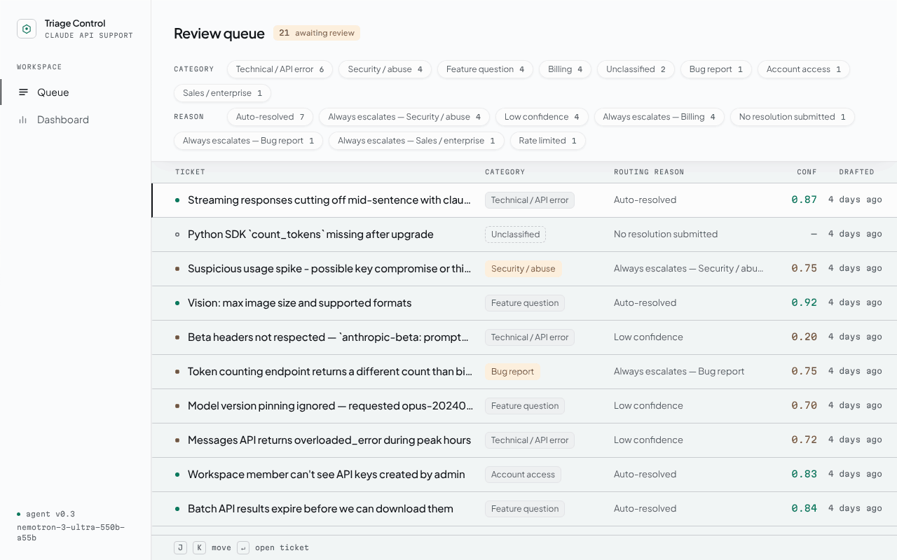
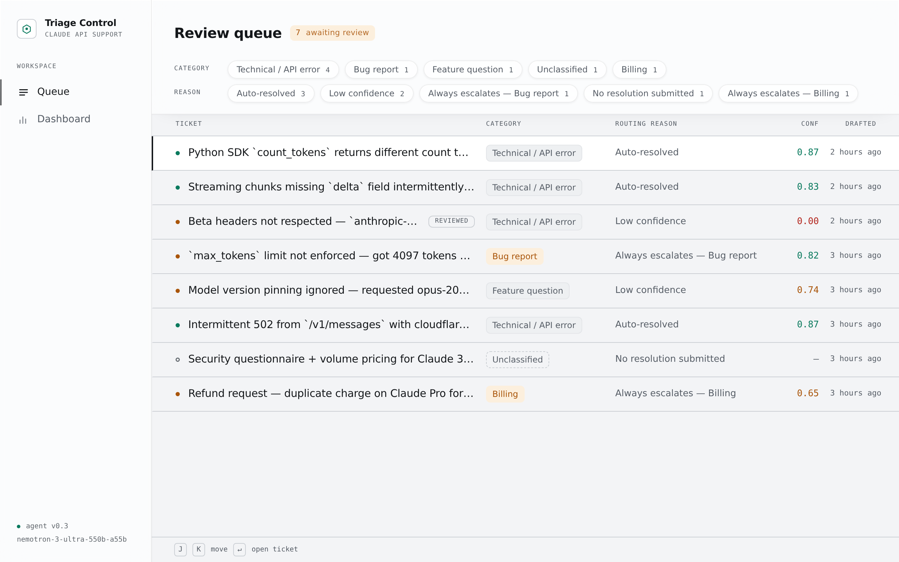
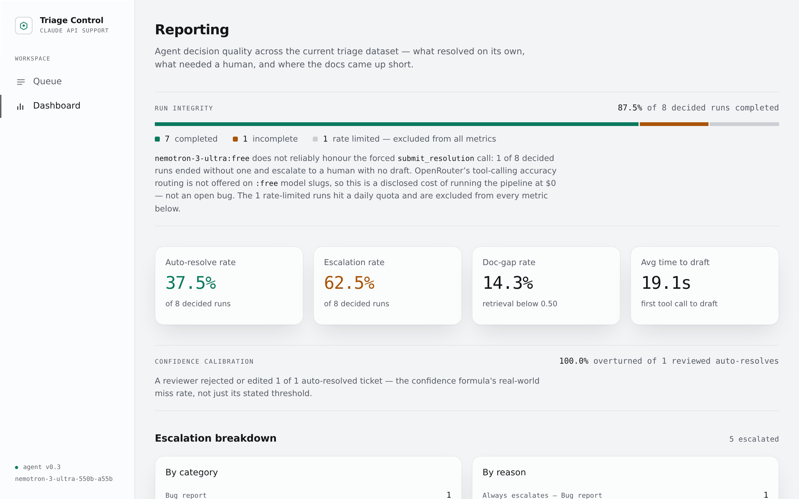

# Claude Support Triage Agent

An AI agent that triages Claude API developer support tickets end-to-end: it
classifies the ticket, grounds itself in Anthropic's real public
documentation, calls live and mocked tools, drafts a citable response with
two independent confidence signals, and hands off to a human whenever the
category or the confidence says it should. A rules-based routing engine —
not the model — makes that final call, and every tool call is logged so any
decision is fully explainable after the fact.

*Independent portfolio project. Not affiliated with or endorsed by
Anthropic. Grounding corpus is Anthropic's public documentation only — no
private or scraped data anywhere in this repo (see [Data policy](#data-policy)).*

## Why this exists

Every API company's support queue splits into two very different tiers: a
large volume of repetitive, doc-answerable questions (rate limits, pricing,
migration steps) and a smaller tier of genuinely sensitive tickets — billing
disputes, security reports, enterprise sales, bug reports — where a wrong
autonomous answer is expensive. Most triage tooling treats every ticket the
same. This project asks a narrower question: can an agent tell the
difference, answer the first tier on its own with citations, and route the
second tier to a human with enough context that the human doesn't have to
start from zero?

## Screenshots



| Review queue | Ticket detail |
|---|---|
|  |  |



*(Screenshots and GIFs use synthetic fixture data for illustration — see
[Data policy](#data-policy).) The deployed app opens on an intro page at `/`
(features, a walkthrough, an interactive routing calculator that runs the real
`route()`, results and architecture); **Try now** opens the queue.*

## Results

Two full runs of the same 40-ticket synthetic dataset through the identical
routing formula — only the orchestration model changed. This was a
deliberate experiment, not an accident: `OPENROUTER_MODEL` is an environment
variable specifically so the free-vs-paid comparison could be measured
rather than guessed at.

| | Free (`nemotron-3-ultra:free`) | Paid, Exacto-routed (`deepseek-v3.2:exacto`) |
|---|---|---|
| Auto-resolved | 8 (20%) | 15 (37.5%) |
| Escalated | 12 (30%) | 22 (55%) |
| Incomplete — no `submit_resolution` call | 20 (50%) | 3 (7.5%) |
| Cost | $0 | $0.25 |

**The finding, not just the number:** the free model misses the forced
`submit_resolution` tool call on roughly 40–50% of tickets. OpenRouter's
Exacto tool-calling-accuracy routing isn't offered on `:free` model slugs,
so there's no configuration fix while staying at $0 — this is a disclosed
reliability/cost tradeoff, stated plainly rather than hidden. The paid run
is what the live queue and dashboard demonstrate against; `orchestrator.ts`
still defaults to the free model and only switches on an explicit env
override, so the comparison stays reproducible.

## Architecture

```
docs.claude.com   ─┐
support.claude.com ─┼─▶ ingestion (chunk + embed) ─▶ Supabase / pgvector
status.claude.com  ─┘

ticket ─▶ agent orchestrator (tool-calling loop) ─▶ routing engine ─┬─▶ auto-resolve
              │                                                      └─▶ human review queue
              ▼                                                            │
        tool_calls (audit trail) ◀───────────────────────────────────────┘
                                                                             │
                                                                             ▼
                                                                   reporting dashboard
```

**Agent loop** (`src/lib/agent/orchestrator.ts`) — an OpenAI-compatible
tool-use loop (via OpenRouter) that runs one ticket at a time: the model
calls `search_docs` (pgvector similarity search over the ingested corpus),
`check_status` (a live call to Anthropic's real status page),
`check_pricing`, and `lookup_account` (mocked) as needed, then is forced to
call `submit_resolution` exactly once with a structured category, draft
response, citations, and two confidence numbers. Every call — including the
final one — is written to `tool_calls`, so the reasoning trace in the UI is
reconstructed from the actual audit log, not a summary.

**Routing engine** (`src/lib/agent/routing.ts`) — a small, pure,
independently-tested function, deliberately *not* the model, that makes the
auto-resolve/escalate decision:

```
confidence = 0.6 × retrieval_score + 0.4 × self_certainty

route(ticket):
  if category in [billing, security_abuse, sales_enterprise, bug_report]:
    → escalate, reason = "category:" + category
  elif confidence ≥ 0.8:
    → auto_resolve
  else:
    → escalate, reason = "low_confidence"
```

The four sensitive categories always escalate regardless of how confident
the model claims to be — confidence is treated as a signal that's allowed to
influence routing only where being wrong is cheap. Retrieval quality and
self-reported certainty are also kept as two separate, visible numbers
rather than one opaque score, specifically so a reviewer can tell "the docs
didn't have this" apart from "the docs had it but the model wasn't sure" at
a glance — that distinction drives the dashboard's doc-gap view.

**Data layer** (`src/lib/data/{types,classify,queries}.ts`) — the single
place a raw Postgres row becomes a *meaning* (`resolved | escalated |
incomplete | rate_limited`), so the review queue and the reporting dashboard
can never disagree about what a ticket's outcome was. This module exists
because getting it wrong silently corrupted dashboard metrics twice during
development — see [Engineering notes](#engineering-notes).

## Project structure

```
scripts/
  ingest-docs.ts        Crawl + chunk + embed docs.claude.com / support.claude.com → Supabase
  generate-tickets.ts    Generate ~40 synthetic support tickets via OpenRouter (never scraped)
  run-triage.ts          Run every ticket through the agent loop, write results, print a summary

src/lib/
  agent/
    tools.ts             Tool schemas + implementations (search_docs, check_status, check_pricing, lookup_account)
    orchestrator.ts       The tool-calling loop for one ticket; logs every call to tool_calls
    routing.ts             Pure confidence + routing logic (independently self-tested)
  data/
    types.ts               Shared shapes for the UI layer
    classify.ts             classifyOutcome / parseCitations — pure, side-effect-free, self-tested
    queries.ts               Server-only Supabase reads that assemble the above into UI-ready shapes
  model.ts                  Single source for "which model is running" (env var + display name)
  supabase.ts, embeddings.ts  Supabase admin client, OpenRouter embeddings client

src/app/
  page.tsx                   Intro / marketing page (/)
  (app)/layout.tsx             Sidebar shell shared by the working screens
  (app)/queue/page.tsx         Review queue (/queue)
  (app)/dashboard/page.tsx     Reporting dashboard (/dashboard)
  actions.ts                    Server action for the approve/edit/reject review write-path

src/components/
  landing/                      Intro page: animated hero, walkthrough, routing calculator, results, diagrams
  queue/                        Filterable, keyboard-navigable (j/k/Enter) ticket list
  drawer/                        Ticket detail: reasoning trace, confidence breakdown, cited draft, review actions
  dashboard/                     KPI cards, escalation breakdown charts, doc-gap list

supabase/migrations/            Schema, pgvector setup, RLS + search_path hardening (0001–0005)
```

## Data policy

Grounding corpus is `docs.claude.com` and `support.claude.com` public pages
only. Account data (`accounts` table) is entirely mocked. Test tickets are
LLM-generated synthetic data — never scraped from a real user, forum post,
or support thread. No real Anthropic customer or account data exists
anywhere in this repository.

## Security

Before making this repository public, a Supabase advisor pass plus a manual
review caught Row-Level Security disabled on all six tables, and a prior
unrelated fix that had additionally granted the `anon`/`authenticated` roles
full read/write privilege — meaning the first client-side call made with the
publishable key would have gotten unauthenticated access to every table.
Nothing had broken in practice only because the app is entirely
server-side; that was luck, not design, until `0005_rls_and_search_path.sql`
closed it with two independent layers: revoked grants and RLS enabled with
default-deny. Model-generated citation links and inline markdown links are
also allowlisted to `http(s):` before ever becoming a real `href`, so a
`javascript:`/`data:` URI in a draft response can't render as a clickable
link.

## Engineering notes

A few bugs surfaced during development were worth keeping notes on because
they were the dangerous kind — silent, not crashing:

- **Outcome reclassification bug.** `classifyOutcome` originally read
  `tickets.status` to distinguish resolved from escalated — but the review
  write-path overwrites that same column to `reviewed` on approve/reject,
  silently reclassifying a ticket's outcome the moment anyone reviewed it
  and corrupting every dashboard stat retroactively. Fixed by deriving the
  outcome purely from the immutable `escalation_reason` field instead.
- **A CSS minifier silently dropped a rendering effect.** Next's Turbopack
  CSS minifier saw `backdrop-filter` and `-webkit-backdrop-filter` declared
  adjacently with identical values and treated them as redundant, shipping
  only the vendor-prefixed one — which current Chromium no longer renders on
  its own. The glass panels looked like flat, unblurred boxes with no error
  anywhere. Caught via `getComputedStyle` on the built output, not by eye;
  fixed by splitting the declarations into separate `@supports` blocks.
- **Untrusted model output cast without validation.** A non-numeric
  `self_certainty`/`retrieval_score` from the model would silently become
  `NaN` once cast to `Resolution`. Now coerced and validated before use.

## Tech stack

- **Next.js (App Router) + TypeScript**, strict mode, no client-side data
  fetching for the review UI — server components read Supabase directly
- **Supabase** — Postgres, `pgvector` for the doc-chunk embedding store, RLS
  enabled with a default-deny policy (server-side admin client bypasses it
  intentionally; there is no client-side write path in v1)
- **OpenRouter** — the only model provider in this repo, used via the
  OpenAI-compatible `/chat/completions` and `/embeddings` endpoints; the
  orchestration model is swappable via `OPENROUTER_MODEL` (see
  [Results](#results))
- **Vercel** — deploy target

## Setup

```bash
npm install
cp .env.local.example .env.local   # fill in Supabase + OpenRouter credentials
```

Apply the migrations in `supabase/migrations/` to your Supabase project
(SQL editor or CLI), in order, then:

```bash
npm run ingest-docs       # crawl + embed the public docs corpus
npm run generate-tickets  # generate ~40 synthetic tickets
npm run run-triage        # run every ticket through the agent loop
npm run dev                # intro at /, review queue at /queue, dashboard at /dashboard
```

```bash
npm test                  # self-tests: routing, orchestrator coercion, classify/parseCitations, drawer logic
```

Required environment variables:

```
SUPABASE_URL=
SUPABASE_SERVICE_ROLE_KEY=
OPENROUTER_API_KEY=
OPENROUTER_MODEL=          # optional — defaults to the free model; see Results
```

## What's next

- Investigate a `max_tokens`-truncation failure mode the paid run surfaced —
  a `JSON.parse` error on `submit_resolution`'s arguments on 1 of 40
  tickets, likely a long draft response getting cut off mid-payload.
- Feed the doc-gap signal (tickets with the weakest retrieval match) into an
  actual documentation-planning workflow instead of just surfacing it.
- Track the confidence-calibration metric (auto-resolves a reviewer later
  overturned) across a larger review sample to see whether the 0.8
  threshold actually holds up in practice.

## License

MIT — see [LICENSE](./LICENSE).

---

See [CLAUDE.md](./CLAUDE.md) for detailed build history and conventions, and
[docs/PRD.md](./docs/PRD.md) for the original product spec.
