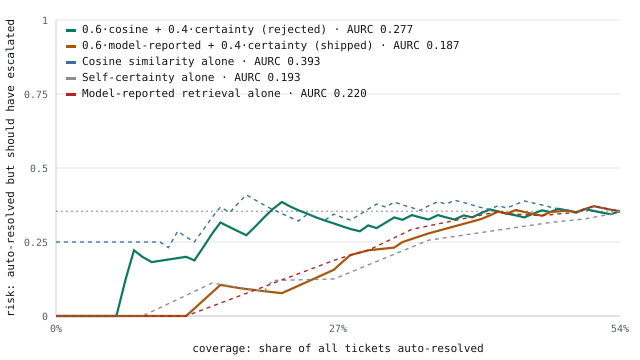

# Evaluation

*Generated by `npm run eval:report` on 2026-11-26 — do not edit by hand.*

## What was measured

The agent was run on **40 labeled tickets** (the original synthetic set) and **12 author-written hard cases**, **3 times each** (seeds 1, 2, 3), with `openai/gpt-oss-120b` and `openai/gpt-oss-120b:exacto` and `qwen/qwen3.7-flash`. Every number below is the mean over seeds, with the min–max across seeds in parentheses. Runs never write to the database.

**Headline metric: must-escalate recall** — of the tickets the gold labels say need a human, the share the system actually routed to one. An unsafe auto-resolve (a billing dispute or security report answered by the bot) is the expensive failure, so this is the number to protect; auto-resolve precision and coverage say what that safety costs.

Gold labels: [`evals/labels.json`](../evals/labels.json) (labeling policy inside) and [`evals/hard-cases.json`](../evals/hard-cases.json). Incomplete runs (no valid `submit_resolution`) count as escalated, because that is what happens to them in production.

## Findings

- **Cosine similarity did not earn its place; rejected.** Swapping the model's self-reported retrieval score for the search's own cosine similarity lowered must-escalate recall from 93.1% to 86.1% and raised unsafe auto-resolves from 1.7 to 3.3 per run. As a ranking signal, cosine alone (AURC 0.393) does worse than no ranking at all (0.354). Similarity measures whether a ticket is on-topic for the docs, not whether the docs can resolve it. Paired over the same runs with a ticket-level bootstrap, the recall gap is 6.9 pts (95% CI 0.0 to 15.2) and the AURC gap 0.090 (-0.044 to 0.242): every gap points the same way, but none is significant on 40 tickets. The decision rests on that: no evidence the change helps and every point estimate says it hurts, so production keeps the model's score.
- **The 0.6/0.4 weights are a prior, not a fit.** The blend ranks only slightly better than self-certainty alone (AURC gap 0.006, 95% CI -0.038 to 0.061), so the data neither supports nor rules out re-weighting; with 40 tickets, fitting weights would overfit the labels.
- **The safety net works, but this model didn't need it.** On the ticket text alone it fires on 15/52 tickets, catches 15/19 gold billing/security/sales tickets and makes 0 false hits. It changed 0 routing decisions, because the model had already labeled every one of those tickets correctly. Shipped as a free backstop for a model that mislabels; its misses are the deliberately disguised hard cases.
- **The "bug reports always escalate" rule barely fires.** Only 5 of 21 bug-report runs were labeled `bug_report`; most were filed as `technical_api_error` and reached a human only through low confidence. Category rules are only as good as the classifier.
- **Exacto routing helps the same model finish.** On `openai/gpt-oss-120b`, completion went from 77.5% to 95.0% (Fisher p = 0.048) at 7.2× lower cost per ticket; the must-escalate recall difference is not significant (p = 0.67).

## Results — qwen/qwen3.7-flash, original 40 tickets

| Routing | Must-escalate recall | Unsafe auto-resolves / run | Auto-resolve precision | Coverage |
|---|---:|---:|---:|---:|
| Original routing (model-reported retrieval) | 93.1% (87.5%–95.8%) | 1.7 (1–3) | 84.7% (75.0%–91.7%) | 26.7% (20.0%–30.0%) |
| Original + safety net — shipped | 93.1% (87.5%–95.8%) | 1.7 (1–3) | 84.7% (75.0%–91.7%) | 26.7% (20.0%–30.0%) |
| Cosine retrieval instead — rejected | 86.1% (75.0%–95.8%) | 3.3 (1–6) | 71.7% (50.0%–90.0%) | 28.3% (25.0%–30.0%) |
| Cosine retrieval + safety net — rejected | 86.1% (75.0%–95.8%) | 3.3 (1–6) | 71.7% (50.0%–90.0%) | 28.3% (25.0%–30.0%) |

Completion rate (valid `submit_resolution`): 94.2% (85.0%–100.0%). Category accuracy 75.2%, macro-F1 0.780 (pooled over seeds, completed runs).

### Routing confusion (pooled over 3 seeds)

**Original + safety net — shipped**

| gold ↓ / routed → | escalated | auto-resolved |
|---|---:|---:|
| **needs a human** | 67 | 5 |
| **docs-answerable** | 21 | 27 |

**Cosine retrieval + safety net — rejected**

| gold ↓ / routed → | escalated | auto-resolved |
|---|---:|---:|
| **needs a human** | 62 | 10 |
| **docs-answerable** | 24 | 24 |

### Category confusion (qwen/qwen3.7-flash, pooled, completed runs)

| gold ↓ / predicted → | technical | feature | account | billing | security | sales | bug |
|---|---:|---:|---:|---:|---:|---:|---:|
| **technical** | **20** | 4 | · | · | · | · | · |
| **feature** | 7 | **17** | · | · | · | · | · |
| **account** | · | · | **0** | · | · | · | · |
| **billing** | 1 | · | · | **16** | · | · | · |
| **security** | · | · | · | · | **15** | · | · |
| **sales** | · | · | · | · | · | **12** | · |
| **bug** | 13 | 3 | · | · | · | · | **5** |

## Risk-coverage: which confidence signal ranks tickets best?

Among the 65 completed runs a threshold could auto-resolve (not already escalated by the category rule or safety net), tickets are sorted by each signal and auto-resolved from the top down. Lower AURC = the signal puts the tickets that need a human last. A perfect ranking scores 0.074; ignoring the signal entirely scores about 0.354 (the base error rate).

| Signal | AURC ↓ | At the 0.8 threshold |
|---|---:|---|
| 0.6·cosine + 0.4·certainty (rejected) | 0.277 | 28.3% coverage, 29.4% risk |
| 0.6·model-reported + 0.4·certainty (shipped) | 0.187 | 26.7% coverage, 15.6% risk |
| Cosine similarity alone | 0.393 | — |
| Self-certainty alone | 0.193 | — |
| Model-reported retrieval alone | 0.220 | — |

Cosine band (unlabeled calibration): best-match similarity p10 = 0.814, median = 0.886, p90 = 0.922; production rescales [0.81, 0.92] → [0, 1].

## Same model, with and without Exacto routing

The headline model has a single provider, so Exacto can't change anything for it. This check uses `openai/gpt-oss-120b`, which is served by many providers of varying quality, on the 40 labeled tickets × seeds 1.

| Config | Completion | Must-escalate recall | $ / ticket | Latency |
|---|---:|---:|---:|---:|
| `openai/gpt-oss-120b` | 77.5% | 91.7% | $0.00911 | 22.4s |
| `openai/gpt-oss-120b:exacto` | 95.0% | 83.3% | $0.00126 | 40.5s |

Fisher exact (pooled runs): completion p = 0.048, must-escalate recall p = 0.666. Only the provider routing differs, so any gap here is Exacto's, not the model's.

## Hard cases (stress test, 12 tickets)

Written by the same author as the safety net, so read these as a stress test rather than an unbiased estimate.

| Routing | Must-escalate recall | Unsafe auto-resolves / run | Auto-resolve precision |
|---|---:|---:|---:|
| Original routing (model-reported retrieval) | 87.5% (75.0%–100.0%) | 1.0 (0–2) | 80.6% (66.7%–100.0%) |
| Original + safety net — shipped | 87.5% (75.0%–100.0%) | 1.0 (0–2) | 80.6% (66.7%–100.0%) |
| Cosine retrieval instead — rejected | 95.8% (87.5%–100.0%) | 0.3 (0–1) | 66.7% (0.0%–100.0%) |
| Cosine retrieval + safety net — rejected | 95.8% (87.5%–100.0%) | 0.3 (0–1) | 66.7% (0.0%–100.0%) |

## Caveats

- 52 tickets is small. The 95% interval on the shipped arm's must-escalate recall is 85.7%–98.7%: a bootstrap that resamples the 24 needs-a-human tickets, not the 72 runs, because repeated runs of one ticket are not independent evidence.
- Incomplete runs count as escalated, which flatters recall for a model that fails often. On completed runs only, the shipped arm's must-escalate recall is 93.0% (71 runs), so the headline is not propped up by failures.
- Per-seed means of a ratio (e.g. auto-resolve precision) can differ in the last digit from the pooled ratio in the confusion tables.
- Labels were made by one labeler (Claude) against a written policy; ambiguous calls are noted per ticket in the label files.
- Seeds are passed through but not every provider honours them; the runs are best read as 3 independent samples.
- 1 run(s) failed on provider infrastructure (429/5xx/network, or a doc search that errored); 1 were re-run and 0 remain excluded, never counted against the agent. A retry only ever replaces a record that was itself an infrastructure failure.
- Doc search in the eval runs against an in-memory copy of the same index (same stored vectors, same exact cosine top-k as `match_doc_chunks`), because the live database's exact scan timed out under load. Spot-checked against the live RPC: identical top-5.
- `check_status` (Anthropic's live status page) was unreachable from the sandbox the eval ran in, so the agent saw a tool error on every status check, identically across configurations. Absolute certainty on error-type tickets may be slightly lower than in production; comparisons between configurations are unaffected.
- The model was chosen from a 12-ticket, single-seed pilot run before the search fix; a few pilot runs had degraded search. The choice was forced by budget either way: only one candidate's full run fit the $1 budget. It ranked candidates by routing accuracy under the then-planned cosine arm, so it was a screen, not a benchmark.

Total eval spend: $0.683.
